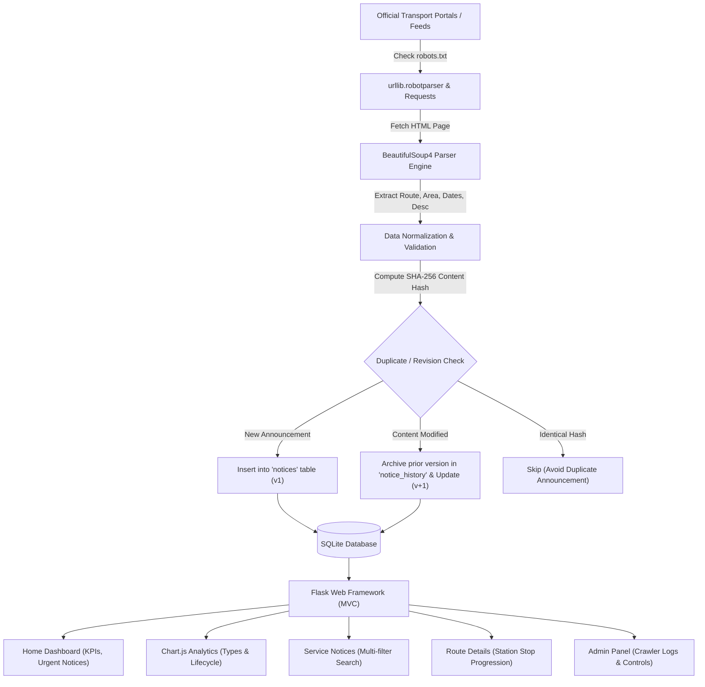
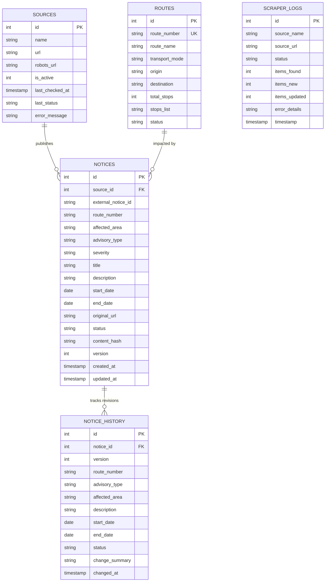

# TransitNotice – Public Transport Service Update Tracker

**TransitNotice** is a web-based public transport monitoring and advisory intelligence platform developed with **Python Flask**, **SQLite**, **Requests**, **BeautifulSoup4**, and **Chart.js**.

The system periodically scans official transport authority bulletins and RSS/HTML feeds, extracts structured alerts (route number, affected area, advisory type, date ranges, and descriptions), stores them in a relational database with SHA-256 revision tracking, distinguishes active notices from outdated/expired historical data, and presents them through an interactive, responsive dashboard.

---

## 1. System Architecture & Workflow



---

## 2. Project Folder Structure

```
mini project 2/
│
├── app.py                     # Main Flask Application (Routes, REST APIs, Mock Portals)
├── database.py                # Database schema, connection factory, seed data & queries
├── scraper.py                 # BeautifulSoup & Requests crawler, robots.txt validator, revision engine
├── requirements.txt           # Python dependency requirements
├── test_app.py                # Automated Pytest suite (15 unit and integration tests)
├── README.md                  # Complete documentation and viva evaluation guide
├── transit_notice.db          # SQLite database file (auto-generated on startup)
│
├── static/
│   ├── css/
│   │   └── style.css          # Responsive CSS design, cards, stop pipeline, badges
│   └── js/
│       ├── dashboard.js       # Chart.js integration (Advisory breakdown & status charts)
│       ├── notices.js         # Revision history modal loader & CSV export
│       └── admin.js          # Admin scraper trigger, live toasts, robots.txt inspector
│
└── templates/
    ├── base.html              # Shared base layout with top status ticker, navbar, footer
    ├── index.html             # Page 1: Home / Dashboard with KPIs, charts, recent notices
    ├── notices.html           # Page 2: Service Notices catalog with multi-field search
    ├── route_detail.html      # Page 3: Route Details with interactive stop progression map
    ├── admin.html             # Page 4: Admin Dashboard with crawler controls & logs
    ├── mock_portal.html       # Simulated Metro Transit Authority official bulletin
    └── mock_bus_feed.html     # Simulated City Bus Corporation disruption feed
```

---

## 3. Database Design & ER Diagram

The database utilizes SQLite with foreign key enforcement and automatic status lifecycle updates.

### Entity Relationship Diagram



### Table Roles
1. **`sources`**: Stores permitted official web sources, URLs, robots.txt pointers, and status.
2. **`routes`**: Stores transit corridors (bus, metro, tram, suburban rail) and JSON station lists.
3. **`notices`**: Primary table containing current advisories, SHA-256 hashes, validity dates, and active versions.
4. **`notice_history`**: Maintains historical audit logs of prior revisions whenever a notice is changed.
5. **`scraper_logs`**: Records every crawl attempt, HTTP status, new notices added, and errors.

---

## 4. Key Functional Modules Explained (For Viva)

### Module 1: Web Scraping Engine (`scraper.py`)
- **Library**: `requests` (for HTTP communication) and `BeautifulSoup4` (for HTML document traversal).
- **Robots.txt Policy**: Uses `urllib.robotparser.RobotFileParser` to verify permissions before sending requests. If a path is disallowed or returns 403, the crawler skips the source and logs an advisory warning without violating site permissions.
- **Polite Identity**: Sends a descriptive `User-Agent: TransitNoticeBot/1.0 (+http://localhost:5000/robots.txt; College Mini Project)`.
- **Error Recovery**: Handles network timeouts, HTTP 404/500 errors, and offline modes gracefully by recording error descriptions into `scraper_logs`.

### Module 2: Duplicate Prevention & Revision Tracking (`scraper.py` & `database.py`)
- **Deterministic Hashing**: A SHA-256 cryptographic digest is computed from:
  $$\text{Hash} = \text{SHA256}(\text{route} \parallel \text{type} \parallel \text{area} \parallel \text{start} \parallel \text{end} \parallel \text{description})$$
- **Identical Notice**: If a scraped notice matches an existing record and has an identical hash, it is ignored (no duplicate records created).
- **Modified Notice (Revision)**: If the announcement exists but the content hash changed:
  1. The existing record's state is preserved as an archived snapshot in `notice_history`.
  2. The notice record is updated with new details, status changed to `Revised`, and `version` incremented (e.g. v1 $\rightarrow$ v2).
  3. A human-readable `change_summary` is recorded (e.g., *"End date updated from 2026-11-05 to 2026-11-10"*).

### Module 3: Active vs. Outdated / Expired Data Display
- Any announcement where $\text{end\_date} < \text{current\_date}$ is automatically updated to `Expired`.
- In the user interface:
  - **Active notices** display green badges with live pulses.
  - **Expired notices** display a prominent red/grey alert: `⚠ Outdated Notice (Historical)` and are visually greyed out so commuters are never misled.

### Module 4: Interactive Stop Progression Pipeline (`route_detail.html` & `style.css`)
- Represents bus and metro corridors as an interactive visual node progression pipeline.
- Automatically compares the notice's `affected_area` against station names. Impacted stations pulse red with warning glyphs (`!`), while unaffected stations remain calm blue.

---

## 5. Step-by-Step Installation & Running in VS Code

### Prerequisites
- Python 3.10, 3.11, 3.12, 3.13, or 3.14 installed on your computer.
- Visual Studio Code.

### Step 1: Open the Project in VS Code
1. Launch **VS Code**.
2. Click **File** $\rightarrow$ **Open Folder...** and select:
   `c:\Users\ELCOT\Desktop\mini project 2`

### Step 2: Open Terminal in VS Code
Press ``Ctrl + ` `` (or select **Terminal** $\rightarrow$ **New Terminal**).

### Step 3: (Optional) Create & Activate Virtual Environment
```powershell
python -m venv venv
.\venv\Scripts\Activate.ps1
```

### Step 4: Install Dependencies
```powershell
pip install -r requirements.txt
```

### Step 5: Run Automated Tests
Verify that all 15 test cases pass:
```powershell
pytest
```
*Expected output: `15 passed in ~1.00s`.*

### Step 6: Start the Flask Application
```powershell
python app.py
```
*Expected terminal output:*
```
Starting TransitNotice - Public Transport Service Update Tracker...
Running on: http://127.0.0.1:5000
 * Serving Flask app 'app'
 * Debug mode: on
 * Running on http://127.0.0.1:5000
```

### Step 7: Open the Application in Browser
Open your web browser and navigate to:
- **Dashboard**: `http://127.0.0.1:5000/`
- **Service Notices**: `http://127.0.0.1:5000/notices`
- **Route Details**: `http://127.0.0.1:5000/routes`
- **Admin Panel**: `http://127.0.0.1:5000/admin`
- **Simulated MTA Portal**: `http://127.0.0.1:5000/mock-transit-portal`
- **Robots.txt**: `http://127.0.0.1:5000/robots.txt`

---

## 6. Test Cases & Expected Outputs

| Test Case ID | Test Description | Input / Action | Expected Result |
| :--- | :--- | :--- | :--- |
| **TC-01** | Database Initialization | Run `python database.py` | Schema tables created; seed data inserted without error. |
| **TC-02** | Dashboard KPI Metrics | Visit `http://127.0.0.1:5000/` | Total Active, Revised, Cancelled, and Expired counts render dynamically. |
| **TC-03** | Chart.js Visualizations | Visit `GET /api/dashboard-stats` | Returns JSON payloads for Doughnut chart (types) and Bar chart (statuses). |
| **TC-04** | Service Notice Filtering | Filter by `type=Diversion` on `/notices` | Only displays Diversion notices (e.g. Route 101 Pipeline Repair). |
| **TC-05** | Outdated Data Demarcation | Inspect notice ADV-2026-004 | Status shows `Expired` with `⚠ Outdated Notice (Historical)` warning tag. |
| **TC-06** | Revision History Modal | Click "History (v2)" on Route BLUE-METRO | Modal opens with timeline showing Version 1 snapshot and change notes. |
| **TC-07** | Route Stop Visualizer | Select `Route 101` on `/routes` | Progression line displays 10 stations; "Grand Avenue" and "Riverfront" pulse red. |
| **TC-08** | Robots.txt Audit Tool | Enter URL on `/admin` inspector | Verifies user-agent permission; allows mock portal and blocks disallowed paths. |
| **TC-09** | Live Scraper Sync | Click "Sync Alerts" button | Scrapes mock HTML portals, checks hashes, adds new/revised items, and toasts result. |
| **TC-10** | Unavailable Source Handling | Scrape unreachable URL | Logs `FAILED` status and displays descriptive connection error in crawler log table. |

---

## 7. Viva / Mentor Evaluation Questions & Answers

**Q1: Why did you choose BeautifulSoup instead of Selenium?**
> *Answer:* Selenium is designed for browser automation and introduces heavy overhead (requires browser binaries, drivers, and high RAM). BeautifulSoup paired with `requests` is lightweight, fast, deterministic, and ideal for parsing server-rendered transport notices without incurring browser launch overhead.

**Q2: How does your application comply with ethical scraping practices?**
> *Answer:* We adhere strictly to ethical guidelines:
> 1. We inspect the website's `robots.txt` directives using `urllib.robotparser.RobotFileParser` before crawling.
> 2. We do not attempt to bypass CAPTCHAs, paywalls, or authentication logins.
> 3. We send a polite, identified User-Agent header with project contact information.
> 4. We implement SHA-256 hashing to avoid redundant queries and repeated duplicate writes.

**Q3: How do you detect when a transit notice is revised?**
> *Answer:* Every notice has its core parameters concatenated and hashed using SHA-256. When a notice with the same external identifier is scraped, we compare its new hash against the stored hash. If the hash differs, the system copies the old record into the `notice_history` table and updates the active notice with incremented version number $v+1$.

**Q4: How do you prevent outdated transit data from misleading users?**
> *Answer:* The system runs an automated expiry checker (`update_expired_statuses`) which compares the announcement's `end_date` with today's date. Notices past their validity are changed to `Expired` status and displayed with distinct muted styling and a prominent `"⚠ Outdated Notice (Historical)"` alert.

**Q5: What happens if an official transport source goes down or loses network access?**
> *Answer:* The crawler wraps network requests in try-except blocks. If a connection fails or returns HTTP errors, the system logs the incident into the `scraper_logs` table with status `FAILED`, updates the source's status to `Error`, and continues displaying previously cached database notices with timestamp labels indicating when the data was last checked.
